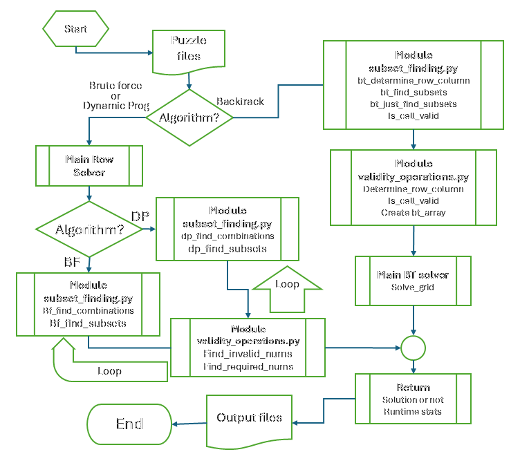

# Number Sums Puzzle Solver
## Solves NxN Number Sums Puzzles Up to N = 20

**Problem**
- _Given_ an NxN grid of integers
- _Where_ each Row and Column have a target integer sum
- Remove integers until the remaining integers on the grid exactly satisfy all Row and Column target sums

**Procedure**
- Iteratively applies a selected AI search algorithm (Backtracking, Brute Force, or Dynamic Programming)
- Proceeds Row-wise and Column-wise across the grid
- Locates integers that must be present to satisfy the target constraint and marks for inclusion
- Locates integers that cannot be present to satisfy the target constraint and deletes them from the grid
- Continues until a unique solution is found, or the maximum number of iterations is reached.

**Program Flowchart**

**Usage**
`python main_solver.py` and follow input prompts

**Other Programs**
`build_puzzle.py` Given a size N, builds a valid puzzle up to N=20
`stat_analysis.py` Performs statistical analysis of results, including plots, descriptive statistics, paired t-tests, and ANOVA

**Project Report and Presentation**
- [Project Report](Project_Report_BillHanson.pdf)
- [Video Presentation](https://youtu.be/ih_-wniEFok)
